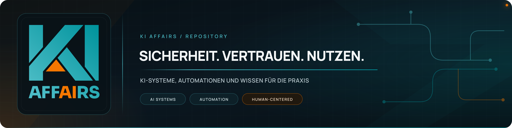
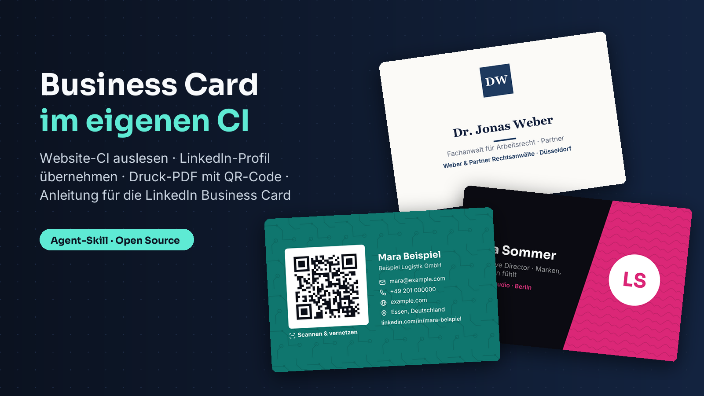

<p align="center"></p>

# Business card in your own brand – agent skill

[Deutsch](README.md) · **English** · [User guide](docs/guide.en.md)

Since October 2026, LinkedIn has its own **Business Card**: a digital card with a QR code that you can add to Apple or Google Wallet. It has limits:
- You design it **only in the mobile app**.
- There are **no custom brand colours**, **no logo field** and **no print file**.

This skill for AI agents (Claude Code, Codex and others) fills that gap:

1. It **reads your website's brand identity**: colours, fonts, logo, corner style.
2. It **imports your LinkedIn profile data** in a legal way, without scraping.
3. It **designs a business card in your brand**: front and back, a QR code to your profile, a print PDF with bleed and a share image.
4. It **tells you exactly what to pick in the LinkedIn app** so the native card matches your brand.

<p align="center"></p>

## What you get

| File | Purpose |
| --- | --- |
| `card-print.pdf` | For the printer: 85 × 55 mm, 3 mm bleed, front and back |
| `front.png`, `back.png` | 300 dpi preview |
| `front.svg`, `back.svg` | Lossless, editable |
| `preview.html` | Both sides in the browser |
| `linkedin-native-card.md` | Step-by-step settings for the LinkedIn app (Info, Layout, Font, Colors, Pattern, Stickers) |
| `report.json` | Check report: contrast, QR size, shortened fields, notes |

## Design options

- **6 layouts:** `classic`, `split`, `centered`, `diagonal`, `minimal`, `profile`
- **8 patterns:** `none`, `dots`, `grid`, `diagonal`, `waves`, `rings`, `circuit`, `chevron`. Tone on tone, so they never reduce contrast.
- **Shapes:** corners `sharp`, `soft`, `round`; photo or monogram as `circle`, `rounded`, `square`, `hexagon`
- **3 colour themes:** `light`, `dark`, `brand`. Readability is enforced: text ≥ 7:1 or ≥ 4.5:1. The QR code is always dark on light.
- **4 formats:** EU card, US card, credit-card size (digital), share image 1200 × 627 px. Use `--lang en` for English labels.

## Quick start

```bash
git clone <repo-url> ~/.claude/skills/linkedin-business-card   # Claude Code; Codex: ~/.codex/skills/
cd ~/.claude/skills/linkedin-business-card && uv sync           # or: python3 -m pip install segno==1.6.6
brew install librsvg                                            # PNG/PDF on macOS; Linux: apt install librsvg2-bin
```

Then ask your agent:

> Create a business card from my LinkedIn profile in the style of https://my-company.com. Profile URL: linkedin.com/in/…

## Important limits

- **The skill cannot fill in the native LinkedIn card for you.** LinkedIn offers no API for it (as of 20 Nov 2026: mobile app only, English only). You get exact step-by-step instructions instead.
- **No LinkedIn scraping.** Profile data comes from your own text, your profile PDF ("Save to PDF") or your data export.
- **No wallet passes.** These need Apple or Google issuer accounts. Use the native LinkedIn card for your wallet.
- **Detected brand identity is a suggestion.** Check colours, logo and font before printing. Proprietary fonts are replaced by a similar font.
- Test the QR code with two phones before printing. Print results are not guaranteed.

## For developers

Run the tests with `uv run pytest`. Security notes are in [SECURITY.md](SECURITY.md). Licence: [MIT](LICENSE). Third-party notices: [THIRD_PARTY_NOTICES.md](THIRD_PARTY_NOTICES.md).

*This project is not affiliated with or endorsed by LinkedIn. LinkedIn is a trademark of LinkedIn Corporation.*

A project by **Claus Zeißler · KI AffAIrs**.
