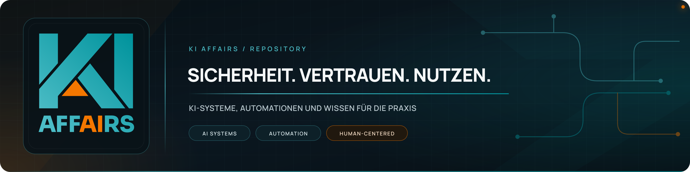
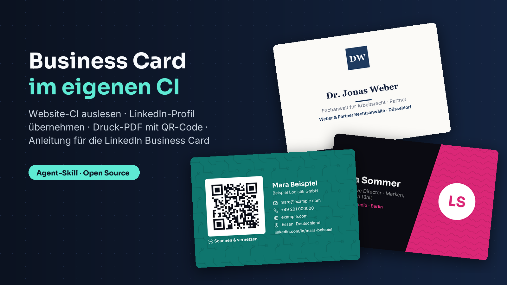
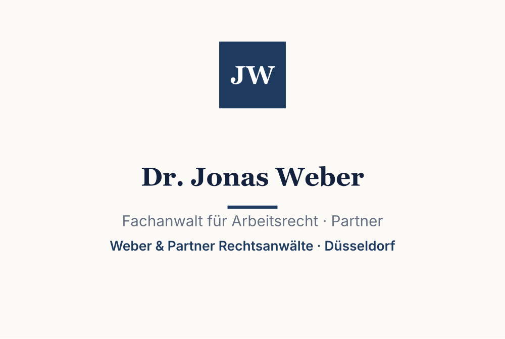
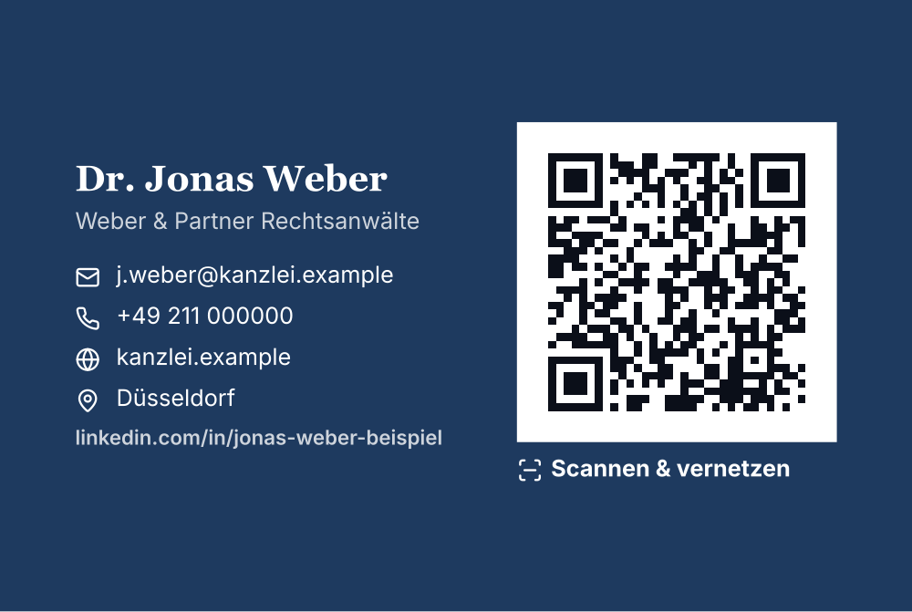
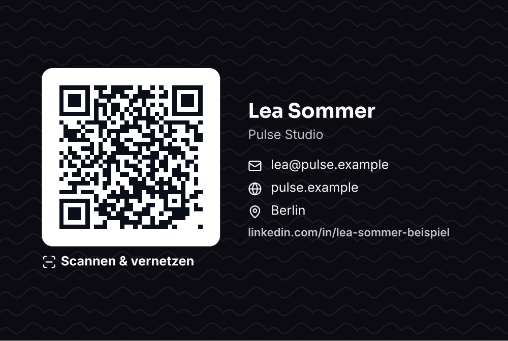

<p align="center"></p>

# Business Card im eigenen CI – Agent-Skill

**Deutsch** · [English version](README.en.md) · [Anleitung (einfach erklärt)](docs/anleitung.md) · [User guide (English)](docs/guide.en.md)

Seit Oktober 2026 hat LinkedIn eine eigene **Business Card**: eine digitale Visitenkarte mit QR-Code, die man in Apple oder Google Wallet legen kann. Sie hat aber Grenzen:
- Gestaltet wird sie **nur in der App**.
- Es gibt **keine eigenen Markenfarben**, **kein Logo-Feld** und **keine Druckdatei**.

Dieser Skill für KI-Agenten (Claude Code, Codex & Co.) schließt die Lücke:

1. Er **liest das Corporate Design deiner Website aus**: Farben, Schriften, Logo, Rundungen.
2. Er **übernimmt deine LinkedIn-Profildaten**, und zwar legal, ohne Scraping.
3. Er **gestaltet eine Business Card in deinem CI**: Vorder- und Rückseite, QR-Code zu deinem Profil, Druck-PDF mit Beschnitt, Bild zum Teilen.
4. Er **sagt dir genau, was du in der LinkedIn-App wählen musst**, damit die native Karte zu deinem CI passt.

<p align="center"></p>

## Was du bekommst

| Datei | Wofür |
| --- | --- |
| `card-print.pdf` | Für die Druckerei: 85 × 55 mm, 3 mm Beschnitt, Vorder- und Rückseite |
| `front.png`, `back.png` | Vorschau in 300 dpi |
| `front.svg`, `back.svg` | Verlustfrei, zum Weiterbearbeiten |
| `preview.html` | Beide Seiten im Browser ansehen |
| `linkedin-native-card.md` | Klick-Anleitung für die LinkedIn-App (Info, Layout, Font, Colors, Pattern, Stickers) |
| `report.json` | Prüfbericht: Kontraste, QR-Größe, gekürzte Felder, Hinweise |

## Gestaltung: Formen, Farben, Muster

- **6 Layouts:** `classic`, `split`, `centered`, `diagonal`, `minimal`, `profile`
- **8 Muster:** `none`, `dots`, `grid`, `diagonal`, `waves`, `rings`, `circuit`, `chevron`. Ton in Ton, damit sie nie den Kontrast senken.
- **Formen:** Ecken `sharp`, `soft`, `round`; Foto oder Monogramm als `circle`, `rounded`, `square`, `hexagon`
- **3 Farbschemata:** `light`, `dark`, `brand`. Lesbarkeit ist garantiert: Text ≥ 7:1 bzw. ≥ 4,5:1. Der QR-Code ist immer dunkel auf hell.
- **4 Formate:** Visitenkarte EU, Visitenkarte US, Scheckkarte (digital), Teilen-Bild 1200 × 627 px

| Kanzlei · `centered` · `none` | Kreativstudio · `diagonal` · `waves` · `dark` |
| --- | --- |
|  |  |
|  |  |

Alle Personen und Firmen in den Beispielen sind erfunden.

## Schnellstart

```bash
git clone <repo-url> ~/.claude/skills/linkedin-business-card   # Claude Code; für Codex: ~/.codex/skills/
cd ~/.claude/skills/linkedin-business-card && uv sync           # oder: python3 -m pip install segno==1.6.6
brew install librsvg                                            # für PNG/PDF (macOS); Linux: apt install librsvg2-bin
```

Danach im Agenten einfach schreiben:

> Erstelle mir eine Business Card aus meinem LinkedIn-Profil im Stil von https://meine-firma.de. Profil-URL: linkedin.com/in/…

Oder direkt im Terminal:

```bash
uv run python scripts/extract_ci.py https://meine-firma.de --out brand/
uv run python scripts/parse_profile.py --pdf Profile.pdf --out profile.json
uv run python scripts/make_card.py --profile profile.json --brand brand/brand.json --out karte/ --layout split --pattern circuit --gallery
```

Die ausführliche Anleitung steht in [docs/anleitung.md](docs/anleitung.md).

## Wichtige Grenzen

- **Die native LinkedIn-Karte füllt der Skill nicht automatisch aus.** LinkedIn bietet dafür keine Schnittstelle (Stand 20.11.2026, nur Mobile-App, Englisch). Du bekommst eine genaue Klick-Anleitung.
- **Kein Scraping von LinkedIn.** Profildaten kommen aus deinem Text, dem Profil-PDF („Als PDF speichern“) oder deinem Datenexport.
- **Keine Wallet-Pässe.** Dafür braucht es Apple- bzw. Google-Konten. In die Wallet kommt die native LinkedIn-Karte.
- **Automatisch erkanntes CI ist ein Vorschlag.** Farben, Logo und Schrift vor dem Druck prüfen. Hausschriften sind oft nicht frei verfügbar; dann wird eine ähnliche Schrift genutzt.
- Vor dem Druck den QR-Code mit zwei Handys testen. Es gibt keine Garantie für Druckergebnisse.

## Für Entwickler

- Tests: `uv run pytest` (174 Tests: QR-Dekodierung, Kontraste, Textumbruch, Missbrauchsfälle)
- Sicherheit: [SECURITY.md](SECURITY.md) – Schutz gegen Abrufe ins interne Netz (SSRF), Markup-Injection und übergroße Dateien
- Skill-Anweisungen für Agenten: [SKILL.md](SKILL.md) · Fakten zur LinkedIn-Karte: [references/linkedin-native-card.md](references/linkedin-native-card.md)
- Lizenz: [MIT](LICENSE). Icons: [Lucide](https://lucide.dev) (ISC). QR: [segno](https://github.com/heuer/segno) (BSD-3). Siehe [THIRD_PARTY_NOTICES.md](THIRD_PARTY_NOTICES.md).

*LinkedIn® ist eine eingetragene Marke der LinkedIn Corporation bzw. ihrer verbundenen Unternehmen. Die Nennung beschreibt nur, wofür das Werkzeug gedacht ist, und bedeutet keine Verbindung zu LinkedIn und keine Unterstützung durch LinkedIn.*

Ein Projekt von **Claus Zeißler · KI AffAIrs**.
